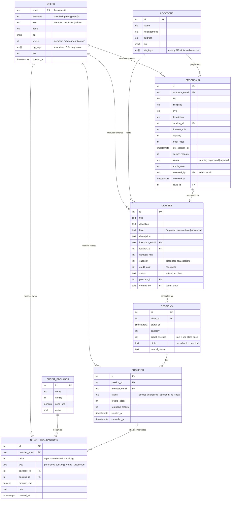

# StudioPass — Entity Relationship Diagram (Week 1)

GitHub and VS Code render this Mermaid diagram. The Postgres tables are created by [`db/migrations/001_init.sql`](../db/migrations/001_init.sql).

## Notes

- **Users are keyed by email.** `users.email` is the primary key, and everything a user creates or owns points back to it: `bookings.member_email`, `credit_transactions.member_email`, `proposals.instructor_email`, `classes.instructor_email`, and `created_by` / `reviewed_by` for admin actions.
- **Passwords are plain text** on purpose: it's a student prototype. Sign-up only checks the email isn't already taken.
- **Credits** are stored as a running balance on `users.credits` *and* as an append-only ledger in `credit_transactions`. The balance always equals the sum of the member's ledger deltas, and the tests check this.
- **Price** of a session is `coalesce(sessions.credit_override, classes.credit_cost)`. The rule-based dynamic pricing planned for week 5 will write to `credit_override`.
- **ZIP filtering**: a class matches a ZIP when its location's `zip` equals it or the location's `zip_tags` contain it.
